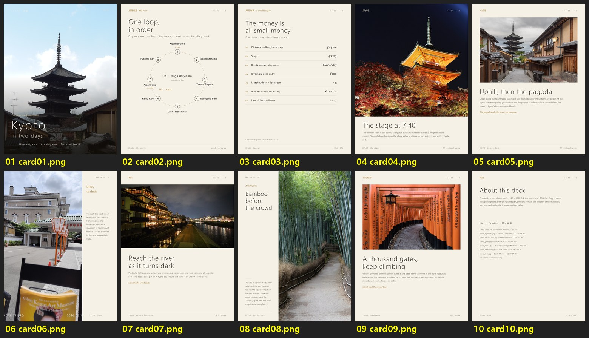
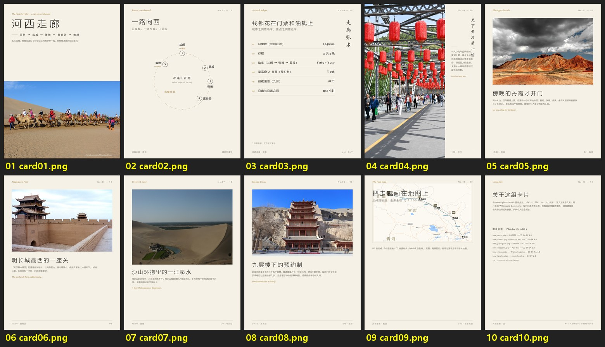

# travel-photo-cards

**Turn a folder of travel photos into a ready-to-post deck of 3:4 cards — the way photo essays look on Xiaohongshu / RED and Douyin, but typeset like a printed journal.**

**把一叠旅行照片排成一套可直接发布的 3:4 图文卡片 —— 小红书/抖音的规格，印刷刊物的气质。**

One deck = 1242×1656 px cards (3:4): cover → route → a small ledger → one card per stop → the real map → colophon, 10–18 cards total. Everything is authored in a single HTML file, rendered to an exact-size multi-page PDF, then cut into per-card PNGs. Type, margins and full-bleed placement are under your control; photos keep their native aspect ratios — zero squeezing.

---

## Examples

All three example decks are built on **freely-licensed Wikimedia Commons photos** (authors and licenses credited on each deck's colophon card).

### Kyoto in Two Days — English deck (10 cards)



### 京都两日 — Chinese deck (10 cards)


### 河西走廊 Hexi Corridor — Chinese deck with a real stitched map (10 cards)



Full-size PNGs live in `examples/*/cardpng/`; publish-named decks and sources are zipped in `examples/*/deck_en.zip` and `examples/*/小红书图文_*.zip`.

---

## How it works

Each card is one `<div>` in `cards.html`. Scripts do the parts that must be exact:

1. **Prep** — `prep_photos.py` EXIF-transposes mobile originals (they'd render sideways otherwise) and caps the long edge at 2000px, printing each photo's true dimensions.
2. **Select** — `contact_sheet.py` builds numbered contact sheets so you review before choosing.
3. **Lay out** — `aspect_row.py` computes equal-height photo rows from **real aspect ratios** (portrait in tall slots, landscape in wide slots; if it doesn't fit, drop it — a weird crop is worse than one fewer photo).
4. **Render** — `html2pdf.py` prints the HTML to an exact 1242×1656 multi-page PDF via the first renderer it finds: Python Playwright → Node Playwright → your installed Edge/Chrome.
5. **Cut & QA** — `render_cards.py` slices the PDF into same-size PNGs (dpi=96 = exact CSS px); `review_montage.py` assembles a montage for card-by-card inspection. Page count > card count means text overflow — fix and re-render.
6. **Package** — `package_cards.py` renames PNGs to publish names and zips them with the source HTML/PDF.

### Quickstart

```bash
pip install pillow pymupdf
pip install playwright && playwright install chromium   # or rely on installed Edge/Chrome

python scripts/prep_photos.py <photo_dir> photos_work
python scripts/contact_sheet.py photos_work select
# author cards.html (see examples/), then:
python scripts/html2pdf.py cards.html cards.pdf
python scripts/render_cards.py cards.pdf cardpng
python scripts/review_montage.py cardpng montage.jpg 5
python scripts/package_cards.py cardpng names.txt my_deck
```

### Scripts

| Script | What it does |
|---|---|
| `prep_photos.py` | EXIF-transpose + downscale; prints true W×H per photo |
| `contact_sheet.py` | Numbered contact sheets for selection |
| `aspect_row.py` | Native-ratio photo row/hero-pair HTML generators |
| `fetch_commons.py` | Search/download Wikimedia Commons; auto-appends `credits.tsv`; retries via wsrv.nl proxy when upload.wikimedia.org is unreachable |
| `html2pdf.py` | HTML → exact-size PDF (Playwright / Edge / Chrome autodetect) |
| `render_cards.py` | PDF → same-size PNGs |
| `review_montage.py` | QA montage of rendered cards |
| `package_cards.py` | Publish-name rename + zip |
| `amap_route_map.py` | Real route map: AMap tile mosaic + dashed route/day badges/distance labels (JSON-config driven) |

---

## Design system — the cream editorial look

- Paper `#F5F1E8`, ink `#26221C`, single accent ochre `#A6803C`
- Headlines: **thin, large, widely tracked** (weight 300, letter-spacing 6–8px CJK / 2–3px Latin)
- English accents in Georgia italic (`Route, in order`, `No.04 — 10`)
- Vertical CJK type (`writing-mode: vertical-rl`) standing beside photos — the signature move
- Separators are 0.5–1px hairline ledger rules only: **no rounded corners, no color blocks, no filled boxes**
- Photos run full-bleed to card edges with generous paper left over; cover text sits on a dark vignette

**Iron rules** (each earned in production):

1. Slot ratio = the photo's native ratio. Read real dimensions with PIL; never eyeball.
2. If it doesn't fit, drop it — a strange crop hurts more than one fewer photo.
3. Never reuse the same photo across cards (cover background excepted).
4. Full-width banners only for landscape or abstract shots; a portrait in a banner is a disaster.
5. Schematic maps show order only; on real maps keep labels sparse and haloed — dense annotation over map tiles always collides.

---

## 中文说明

**产出规格**：单卡 1242×1656（3:4，小红书/抖音通用），一个 HTML 渲染成多页 PDF 再切 PNG；封面 → 路线 → 账本 → 逐站卡 → 真实路线图 → 尾注，10–18 张。

**工作流**：`prep_photos.py` 转正+缩图（输出真实宽高）→ `contact_sheet.py` 拼版选图 → 槽位用 `aspect_row.py` 按原生比例计算（放不下就删，不压扁）→ `html2pdf.py` 渲染（自动发现 playwright / Edge / Chrome）→ `render_cards.py` 切 PNG → `review_montage.py` 蒙太奇逐张目检（页数>卡片数=有溢出）→ `package_cards.py` 按发布名打包。

**设计系统（米白编辑刊）**：纸底 `#F5F1E8` / 墨字 `#26221C` / 赭金点缀 `#A6803C`；大标题细、大、疏；英文 Georgia 斜体点缀；竖排汉字立图片旁；分隔只用发丝线账本行，无圆角无色块；照片通栏出血；封面文字压暗部渐晕。**铁律**：槽位=原生比例、放不下就删、不跨卡重复用图、竖图不进横幅、真实地图文字克制加描边晕。

**公共图片来源**：`fetch_commons.py search/download` 搜图并自动记 `credits.tsv`（文件|作者|许可|来源页），**CC 许可信息必须写进尾注卡**；国内直连失败自动走 wsrv.nl 代理；API 429 已内置退避。

---

## Use it as an agent skill

The root `SKILL.md` installs into skill-capable agents (Claude Code, ZCode, …) and drives the whole pipeline — selection, copywriting, layout, rendering, packaging. The three example decks were produced this way.

## License

- Code & layout templates: **MIT**
- `examples/` photographs: © their authors, under the per-card licenses (CC BY / CC BY-SA / CC0)
- Real-map basemaps are AMap public tiles, for personal keepsake use; check platform and surveying-compliance rules before publishing map imagery

## Acknowledgements

The design language was tuned by real feedback, one sentence at a time: *"if it doesn't fit, leave it out"*, *"thin, large, sparse"*, *"dense labels over a real map always collide."*
